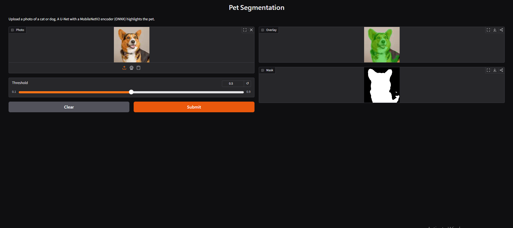

# Pet Segmentation

Semantic segmentation of cats and dogs on the Oxford-IIIT Pet dataset. Given a photo, the model predicts which pixels belong to the pet and which belong to the background.

The project covers the full workflow: data preparation, training, experiments, evaluation, optimization and a working demo (REST API + web page).



## Results at a glance

| Model | Params | Val IoU | Test IoU | Test Dice |
|---|---|---|---|---|
| U-Net from scratch | 7.8M | 0.7611 | 0.7669 | 0.8596 |
| U-Net + ResNet34 (pretrained), BCE | 24.4M | 0.9052 | 0.9044 | 0.9472 |
| U-Net + ResNet34, BCE + Dice | 24.4M | 0.9051 | 0.9075 | 0.9490 |
| U-Net + ResNet34, BCE + Dice + augmentation | 24.4M | 0.9054 | 0.9071 | 0.9486 |
| U-Net + MobileNetV2, BCE + Dice + augmentation | 6.6M | 0.9029 | | |

Optimization (CPU, batch size 1, first 300 test images):

| Version | Size (MB) | CPU ms / image | IoU |
|---|---|---|---|
| ResNet34, PyTorch FP32 (baseline) | 97.9 | 212.7 | 0.8969 |
| ResNet34, ONNX FP32 | 97.7 | 149.6 | 0.8969 |
| ResNet34, ONNX INT8 | 24.7 | 104.7 | 0.8697 |
| MobileNetV2, PyTorch FP32 | 26.8 | 111.9 | 0.8985 |
| **MobileNetV2, ONNX FP32 (used in demo)** | **26.5** | **73.0** | **0.8985** |
| MobileNetV2, ONNX INT8 | 7.1 | 59.0 | 0.8517 |

The model used in the demo is 3.7x smaller and 2.9x faster than the baseline with the same accuracy.

Full discussion is in [REPORT.md](REPORT.md).

## Project structure

```
pet-segmentation/
    src/
        dataset.py     data loading, resizing, normalization, augmentation, train/val/test split
        model.py       U-Net from scratch + pretrained U-Nets (ResNet34, MobileNetV2)
        losses.py      BCE and BCE + Dice loss
        metrics.py     IoU and Dice
        train.py       training loop, saves best checkpoint and appends results to results.csv
        evaluate.py    test set scores + best/worst prediction pictures
        explore.py     dataset statistics and sample pictures
        optimize.py    ONNX export, INT8 quantization, CPU benchmark
    app/
        app.py         FastAPI + Gradio demo (ONNX Runtime, no PyTorch needed)
        requirements.txt
    models/
        mobilenet_fp32.onnx   trained model used by the demo
    results/           tables and pictures from all experiments
    REPORT.md          technical report
    requirements.txt   libraries for training
```

## Run the demo

Needs Python 3.10+. Only the demo libraries are needed, no PyTorch or GPU.

```bash
git clone https://github.com/NikaGiorgadze713/pet-segmentation.git
cd pet-segmentation
python -m venv venv
venv\Scripts\activate          # Windows
# source venv/bin/activate     # Linux / macOS
pip install -r app/requirements.txt
python app/app.py
```

Then open:
- http://127.0.0.1:8000/demo : web page, upload a photo and see the result
- http://127.0.0.1:8000/docs : API documentation

### API

`POST /predict` takes an image file and returns a PNG.

| Parameter | Default | Meaning |
|---|---|---|
| `threshold` | 0.5 | probability above which a pixel counts as pet |
| `overlay` | false | `false` returns the black and white mask, `true` returns the photo with the pet highlighted |

```bash
curl -X POST "http://127.0.0.1:8000/predict?overlay=true" -F "file=@dog.jpg" --output result.png
```

`GET /health` returns `{"status": "ok"}`.

## Train and reproduce

Training was done on Google Colab (free T4 GPU). Each run takes about 5 to 7 minutes.

```python
!pip install -q segmentation-models-pytorch onnx onnxruntime
!git clone https://github.com/NikaGiorgadze713/pet-segmentation.git
%cd pet-segmentation
```

Dataset exploration:
```bash
python -m src.explore
```

Experiments:
```bash
python -m src.train --model unet_scratch --epochs 5
python -m src.train --model unet_resnet34 --lr 1e-4 --epochs 5
python -m src.train --model unet_resnet34 --loss bce_dice --lr 1e-4 --epochs 5
python -m src.train --model unet_resnet34 --loss bce_dice --augment --lr 1e-4 --epochs 5
python -m src.train --model unet_mobilenet --loss bce_dice --augment --lr 1e-4 --epochs 5
```

Test set evaluation (scores + best/worst pictures in `results/`):
```bash
python -m src.evaluate --model unet_resnet34 --checkpoint checkpoints/unet_resnet34_bce_dice_aug.pth
```

Optimization and benchmark:
```bash
python -m src.optimize \
  --resnet-checkpoint checkpoints/unet_resnet34_bce_dice_aug.pth \
  --mobilenet-checkpoint checkpoints/unet_mobilenet_bce_dice_aug.pth
```

The dataset (about 800 MB) is downloaded automatically by torchvision on the first run.

Checkpoints (`.pth`) are not stored in the repository because of their size. They can be recreated with the commands above. The model used by the demo is included in `models/`.
