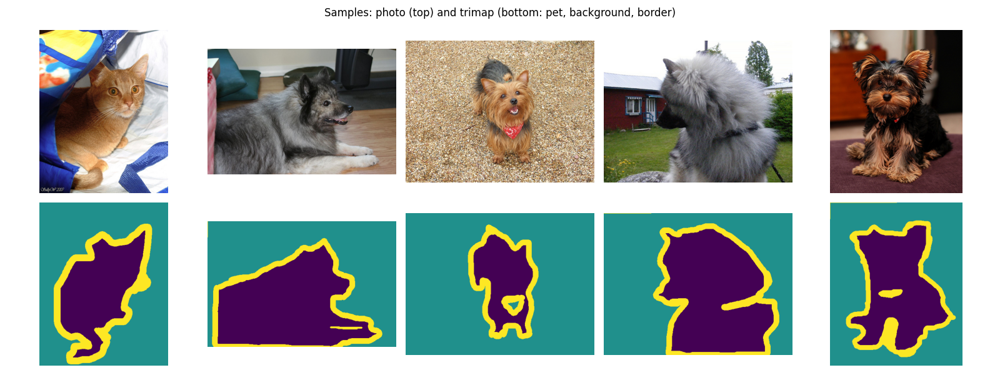
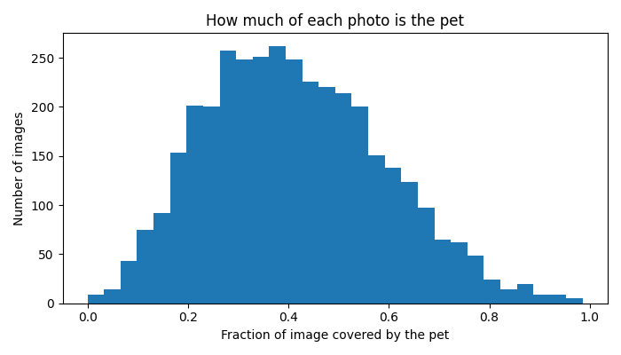
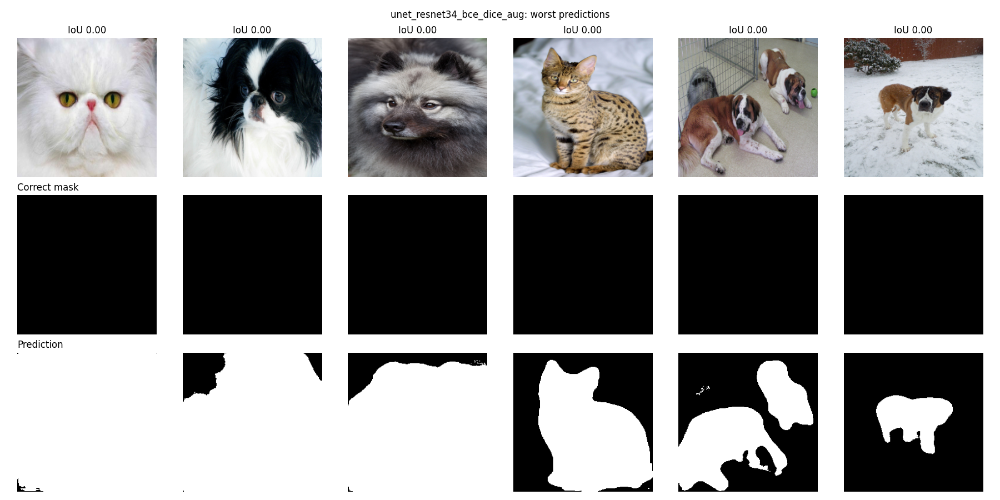

# Technical Report: Pet Segmentation

## 1. What problem does the project solve?

The project does semantic segmentation of cats and dogs. For every pixel of a photo, the model decides if it belongs to the pet or to the background. The result is a mask that cuts the animal out of the photo.

This kind of task is used in photo editing (background removal), in apps that need to know exactly where an object is, and as a building block for more complex vision systems. Compared to classification ("is this a cat?") or detection (a box around the cat), segmentation gives the exact shape of the object.

The final system takes any photo, runs a trained model on CPU in about 73 ms, and returns the mask through a REST API and a simple web page.

## 2. Why this data, model and approach?

### Data

I used the Oxford-IIIT Pet dataset. It was in the suggested list, it has pixel-level masks for every image, and it is small enough to train on a free Colab GPU in minutes.

What I found when exploring it (`src/explore.py`, `results/data_stats.txt`):

| Fact | Value |
|---|---|
| Train/val images | 3,680 |
| Test images | 3,669 |
| Cats / dogs | 1,188 / 2,492 |
| Image width | 114 to 3264 px (median 500) |
| Image height | 108 to 2606 px (median 375) |
| Average share of the image covered by the pet | 41% |
| Masks with no pet pixels at all | 7 in train/val, 7 in test |

The masks are trimaps with three values: 1 = pet, 2 = background, 3 = border. I turned this into a binary task (pet vs background) and counted the border as pet, because the border is the edge of the animal.

Preparation (`src/dataset.py`):
- all images resized to 256x256, because sizes vary a lot and the model needs a fixed input size
- masks resized with nearest neighbour, so they keep only valid class values (normal resizing would blend 0 and 1 into values like 0.5)
- images normalized with ImageNet mean and std, because the pretrained encoders were trained with this normalization
- train/val split 90% / 10% with a fixed seed, so every experiment uses the same split
- the official test split is used only for the final evaluation

### Model

I chose U-Net, the standard architecture for segmentation. The encoder shrinks the image step by step to understand what is in it, the decoder grows it back to full size to draw the mask, and skip connections copy fine details from the encoder to the decoder so edges stay sharp.

I tried three versions:
1. a U-Net written from scratch (`src/model.py`), to have a baseline and to understand the architecture
2. a U-Net with a ResNet34 encoder pretrained on ImageNet (from `segmentation_models_pytorch`)
3. a U-Net with a MobileNetV2 encoder, a much lighter network, for the optimization part

### Training setup

- Optimizer: Adam
- Learning rate: 1e-3 for the scratch model, 1e-4 for pretrained models (smaller steps so the pretrained weights are not destroyed)
- Batch size 16, 5 epochs per run
- The checkpoint with the best validation IoU is saved
- Metrics: IoU (overlap divided by union) and Dice (2 x overlap divided by total area), the standard segmentation metrics

## 3. Experiments and results

All experiments use the same data split and 5 epochs on a Colab T4 GPU. The model was chosen by validation IoU, and test scores were computed once at the end on all 3,669 test images.

| # | Experiment | Params | Val IoU | Test IoU | Test Dice | Time / epoch |
|---|---|---|---|---|---|---|
| 1 | U-Net from scratch, BCE | 7.8M | 0.7611 | 0.7669 | 0.8596 | ~80 s |
| 2 | ResNet34 pretrained, BCE | 24.4M | 0.9052 | 0.9044 | 0.9472 | ~54 s |
| 3 | ResNet34 pretrained, BCE + Dice | 24.4M | 0.9051 | 0.9075 | 0.9490 | ~54 s |
| 4 | ResNet34 pretrained, BCE + Dice + augmentation | 24.4M | 0.9054 | 0.9071 | 0.9486 | ~54 s |
| 5 | MobileNetV2 pretrained, BCE + Dice + augmentation | 6.6M | 0.9029 | | | ~47 s |

Augmentation: random horizontal flip (image and mask together) and random brightness/contrast (image only).

### What the results show

Transfer learning is the biggest win. The pretrained encoder improved IoU from 0.76 to 0.905. It reached 0.89 after the first epoch, because the encoder already knows edges, fur and shapes from ImageNet and only needs to learn where to draw the mask. The scratch model, after 5 epochs, mostly used color and contrast: it did well on a dog on green grass but failed on a white dog on a white pillow.

The pretrained model is faster per epoch even though it is 3 times bigger (54 s vs 80 s). ResNet34 reduces the resolution very early, so most of its work is done on small feature maps. My scratch U-Net runs its first layers on the full 256x256 image. Parameter count is not the same as speed.

Dice loss and augmentation did not change the score in a meaningful way. Experiments 2, 3 and 4 are within 0.003 IoU of each other, which is within run-to-run noise. A likely reason for Dice: it helps most when the object is small compared to the background, but here the pet covers 41% of the image on average, so plain BCE already works well. For augmentation, the training loss stayed higher (0.157 vs 0.142 for experiment 3) while validation stayed the same, so the model memorizes the training set less. With longer training it would probably help more.

Test scores are very close to validation scores, so there is no hidden overfitting to the validation set.

I kept experiment 4 as the final ResNet34 model because it had the best validation IoU. On the test set experiment 3 is 0.0004 higher, but I did not switch: choosing a model by its test score would make the test score no longer an honest estimate.

### Error analysis

`src/evaluate.py` sorts the test images by IoU and saves the 6 best and 6 worst predictions (`results/*_best.png`, `results/*_worst.png`).

Best cases (IoU 0.99): close-up photos where the pet fills almost the whole image. These are easy because only a small part of the background needs to be correct.

Worst cases (IoU 0.00): in all six, the ground-truth mask is completely empty, even though the photo clearly shows a cat or dog. The model's prediction is actually correct. The scratch model's worst list contains the same images, which confirms that the problem is in the labels, not in the models. `explore.py` counts 7 such empty masks in the test set and 7 in train/val. Each of them counts as IoU 0, so the test IoU without them would be about 0.909 instead of 0.907. The 7 empty masks in training also act as label noise (they teach the model that a visible pet is background).

Other weaker cases seen during training: pets with a color similar to the background, busy backgrounds with strong edges, and thin parts like legs and tails.

## 4. Optimization

Goal: make the model smaller and faster for CPU inference (a cheap server without GPU), and measure what it costs in accuracy.

Methods (`src/optimize.py`):
- ONNX export and inference with ONNX Runtime
- INT8 static quantization with ONNX Runtime (weights and activations stored as 8-bit integers), calibrated on 64 training images
- Lighter encoder: MobileNetV2 instead of ResNet34

Measured on Colab CPU, batch size 1, average of 50 runs; IoU on the first 300 test images:

| Version | Size (MB) | CPU ms / image | IoU |
|---|---|---|---|
| ResNet34, PyTorch FP32 (before) | 97.9 | 212.7 | 0.8969 |
| ResNet34, ONNX FP32 | 97.7 | 149.6 | 0.8969 |
| ResNet34, ONNX INT8 | 24.7 | 104.7 | 0.8697 |
| MobileNetV2, PyTorch FP32 | 26.8 | 111.9 | 0.8985 |
| **MobileNetV2, ONNX FP32 (after)** | **26.5** | **73.0** | **0.8985** |
| MobileNetV2, ONNX INT8 | 7.1 | 59.0 | 0.8517 |

Conclusions:
- ONNX gives about 1.4x speed for free, with exactly the same accuracy.
- INT8 makes models about 4x smaller and faster but loses accuracy: 0.03 IoU for ResNet34 and 0.05 for MobileNetV2. MobileNetV2 suffers more because it is already very compact and uses depthwise convolutions, which are known to be sensitive to quantization.
- MobileNetV2 + ONNX is the best trade-off: 3.7x smaller and 2.9x faster than the baseline with the same accuracy. This is the model used in the demo.

## 5. Practical use (demo)

`app/app.py` serves the MobileNetV2 ONNX model:
- REST API (FastAPI): `POST /predict` returns the mask or an overlay as PNG, with an adjustable threshold. Invalid files return a 400 error.
- Web page (Gradio) at `/demo`: upload a photo, move the threshold slider, see the overlay and the mask.

The demo only needs ONNX Runtime, NumPy and Pillow, not PyTorch, so it installs quickly and runs on any CPU. The preprocessing in the app (resize to 256, scale to 0..1, ImageNet normalization) matches training exactly; if it did not, the model would receive different inputs than it learned from.

## 6. Problems and how I solved them

| Problem | Solution |
|---|---|
| `ModuleNotFoundError: No module named 'src.model'` | The file was saved as `models.PY`. Renamed it to `model.py`. |
| `No module named 'src'` when training in Colab | Colab was in `/content` instead of the project folder after an interrupted cell. Fixed with `%cd /content/pet-segmentation`. |
| Colab deleted trained models when the session reset, and once disconnected during a run | Saved checkpoints and results to Google Drive right after each step. |
| Same results needed across runs | Fixed seed for the data split and for training. A retrained model got 0.9080 val IoU vs 0.9054 the first time, which confirms the results are repeatable within noise. |
| INT8 quantization lost accuracy | Measured it and chose the FP32 ONNX MobileNetV2 for the demo instead. |
| Worst test predictions looked like total failures | Investigated and found empty ground-truth masks, then counted them in the whole dataset. |

## 7. Strengths and weaknesses

Strengths
- Complete pipeline: data, training, experiments, evaluation, optimization and a working API + web demo
- Clear experiment that shows the effect of transfer learning (+0.14 IoU)
- Honest evaluation: model chosen on validation, test used once, test close to validation
- Real speed/size/accuracy comparison, with a final model 2.9x faster and 3.7x smaller with no accuracy loss
- Error analysis that found label errors in the dataset
- Lightweight demo without PyTorch

Weaknesses
- Only 5 epochs and one run per experiment. Differences between experiments 2, 3 and 4 are within noise, so I cannot say if Dice loss or augmentation help.
- The scratch model used a different learning rate than the pretrained models, so that comparison does not use identical settings.
- Optimization was measured on Colab CPU and on 300 test images; absolute times will differ on other machines.
- Some models were retrained on a second day because Colab deleted files. Settings were identical and scores very close, but the optimization table uses the retrained models.
- Binary task only (pet vs background); the border class is merged into pet.
- Input is always 256x256, so very thin details (whiskers, fur edges) are lost on large photos.
- 2x more dogs than cats in the data, which may make the model slightly better on dogs.

## 8. What I would improve with more time and resources

- Train longer (20 to 50 epochs) with a learning rate schedule, and repeat each experiment with several seeds to see which differences are real
- Remove or fix the 14 broken masks and re-evaluate
- Try treating the border class separately (ignore it in the loss, or predict 3 classes)
- Better quantization: more calibration images, model preprocessing before quantization, or quantization-aware training to keep accuracy at INT8
- Higher input resolution or a stronger encoder (for example EfficientNet) for sharper edges
- Measure per-class results (cats vs dogs, by breed) to find weak groups
- Deploy the demo online (for example Hugging Face Spaces) so it can be tried without installing anything

## 9. Use of AI tools

I used Claude (an AI assistant) during this project, mainly as a tutor and to help write the code. I had not used PyTorch or done segmentation before, so I used it to:
- explain the concepts (U-Net, loss functions, IoU/Dice, transfer learning, quantization)
- plan the project and the experiments
- write the first versions of the code, which I then added to the project step by step
- help debug errors

How I checked the results instead of trusting them:
- I ran every step myself in Colab and on my laptop and read the outputs
- before training, I checked tensor shapes, value ranges and that masks only contain 0 and 1
- I looked at predicted masks next to the real masks to make sure the numbers matched what I saw
- I compared validation and test scores to check for overfitting
- I investigated the worst predictions myself, which led to finding the empty masks
- I tested the API and the web demo with my own photos

All the decisions in this report are ones I understand and can explain, and I can change the code myself.
